# YourFrame

**Turn your Android TV or Google TV into a gallery.** When the TV is idle, YourFrame hangs a masterpiece on it:
a painting, a print or a photograph from four of the world's great museums, framed and matted like The Frame,
with the time and a newspaper-style caption.

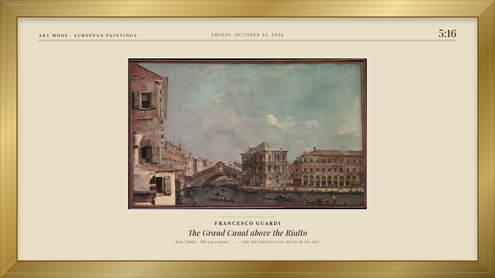

<p align="center">
  <a href="https://github.com/ismaelmelgar/YourFrame/releases/latest"><b>⬇ Download YourFrame.apk</b></a>
  &nbsp;·&nbsp; free and open source &nbsp;·&nbsp; no account, no ads, no tracking
</p>

## A different work every time

More than **6,000 public-domain works** from The Metropolitan Museum of Art, the Cleveland Museum of Art, the National
Gallery of Art in Washington and SMK, the National Gallery of Denmark. Every one is chosen to suit a TV: landscape,
sharp at 1080p, and shown whole, never cropped.

<table>
<tr>
<td width="50%">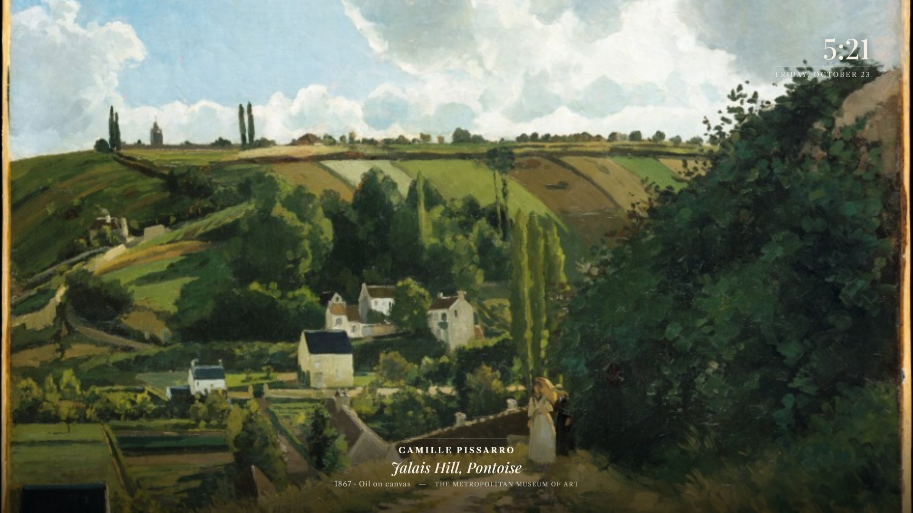<br><sub>Camille Pissarro, Jalais Hill, full bleed · The Met</sub></td>
<td width="50%">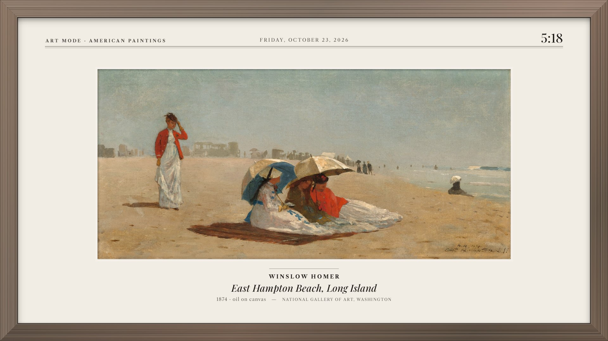<br><sub>Winslow Homer in walnut, on paper · National Gallery of Art</sub></td>
</tr>
<tr>
<td width="50%">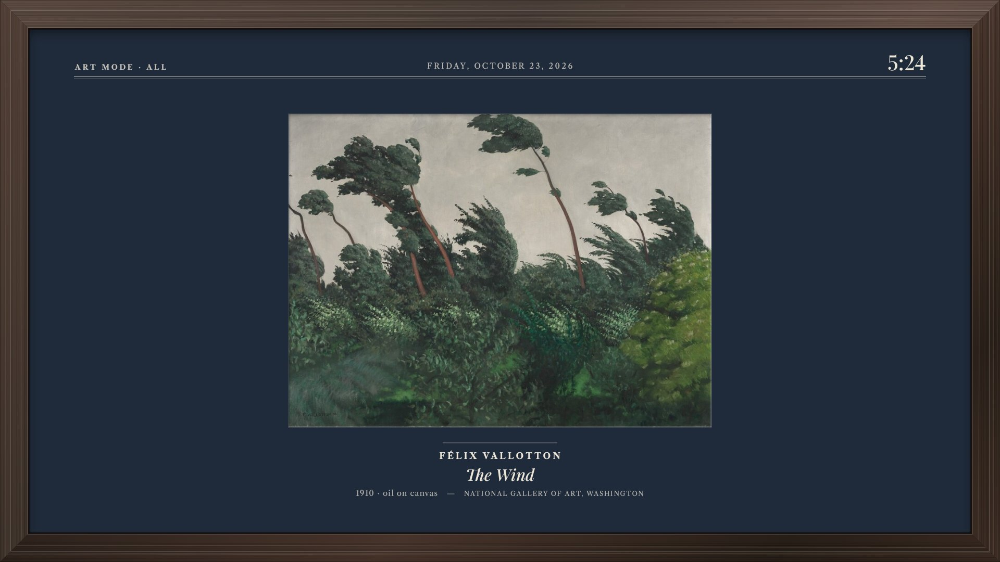<br><sub>Félix Vallotton on a navy mat · National Gallery of Art</sub></td>
<td width="50%">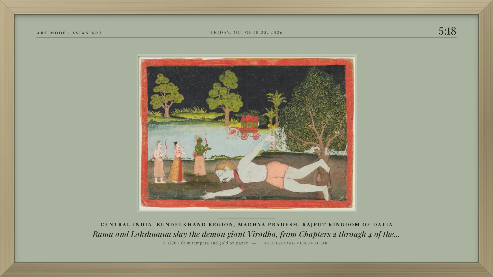<br><sub>A Rajput painting in oak, on sage · Cleveland Museum of Art</sub></td>
</tr>
<tr>
<td width="50%">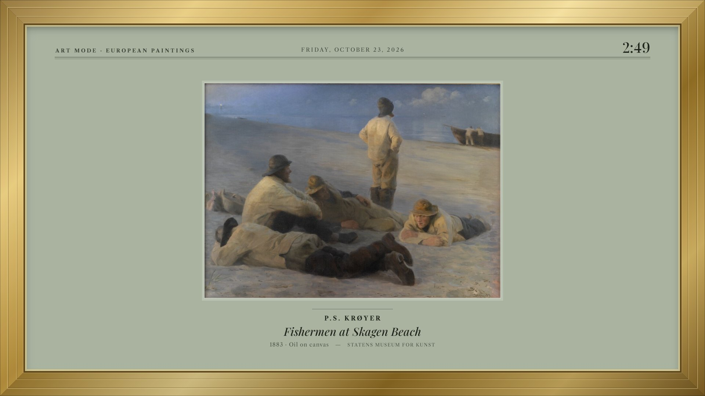<br><sub>P.S. Krøyer in gold · SMK, Copenhagen</sub></td>
<td width="50%">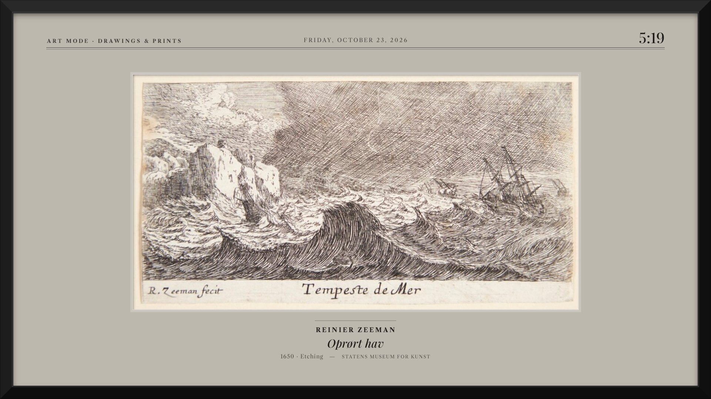<br><sub>An etching in thin black, on stone · SMK, Copenhagen</sub></td>
</tr>
<tr>
<td width="50%">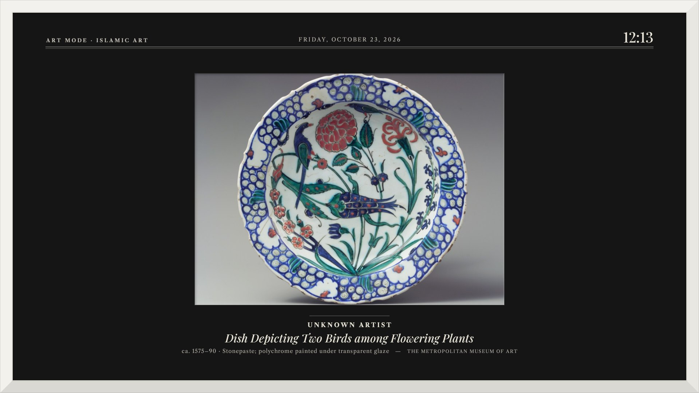<br><sub>An Iznik dish in white, on black · The Met</sub></td>
<td width="50%">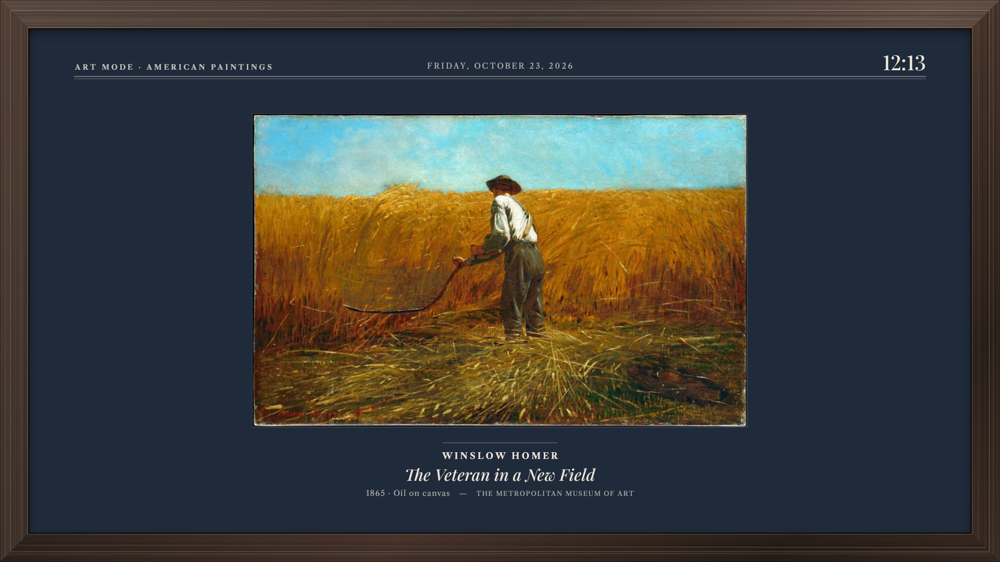<br><sub>Winslow Homer, The Veteran in a New Field · The Met</sub></td>
</tr>
<tr>
<td width="50%">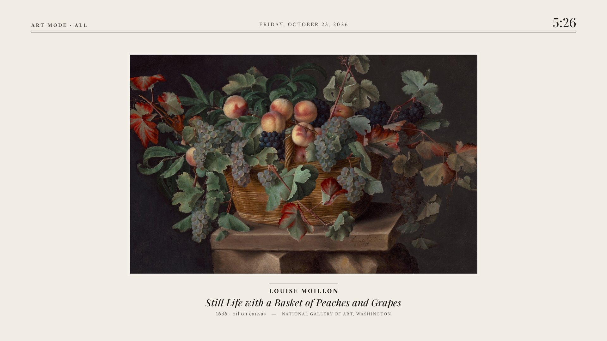<br><sub>Louise Moillon, mat only · National Gallery of Art</sub></td>
<td width="50%">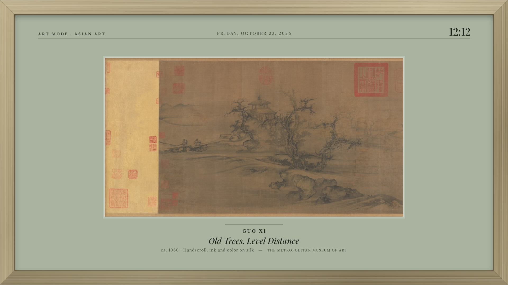<br><sub>Guo Xi, Old Trees, Level Distance · The Met</sub></td>
</tr>
</table>

## Make it yours

- **Seven frames:** full bleed, mat only, thin black, white, oak, walnut and gold.
- **Six mats:** paper, ivory, stone, sage, navy and black.
- **Choose what hangs:** European paintings, American paintings, Asian art, Islamic art, drawings and prints,
  photography, or everything; and which museums.
- **Your pace:** a new work every 30 seconds, 1, 5 or 15 minutes, with a slow crossfade.
- **Quiet at night:** dims itself late in the evening. The caption fades away 10 seconds after each work arrives, and
  the clock can be turned off.
- **Works offline:** the last works shown stay on the TV.
- **English and Spanish**, following the TV's language.

Every change shows up live in the preview while you set it up:

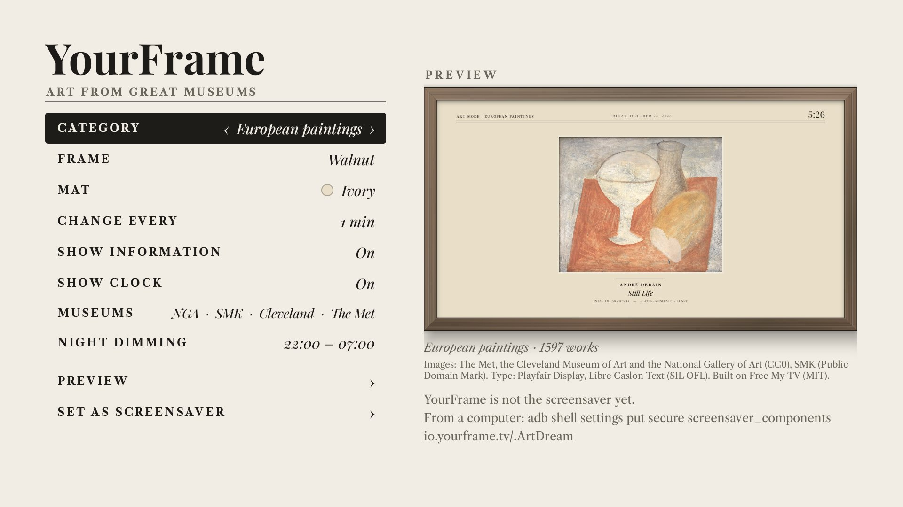

<table>
<tr>
<td width="50%">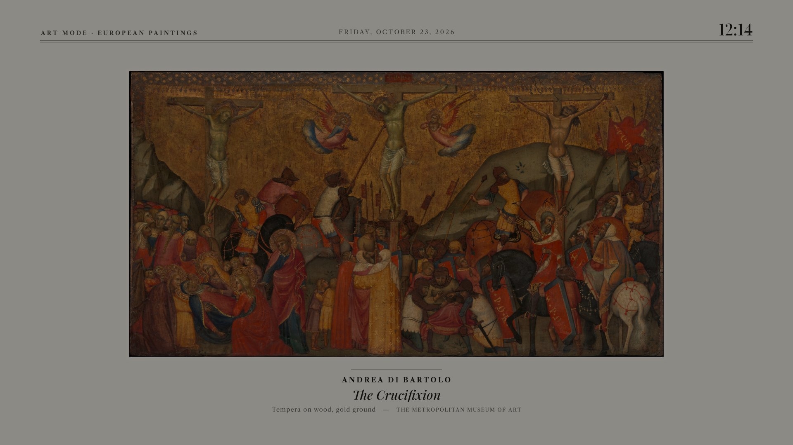<br><sub>Dimmed at night</sub></td>
<td width="50%">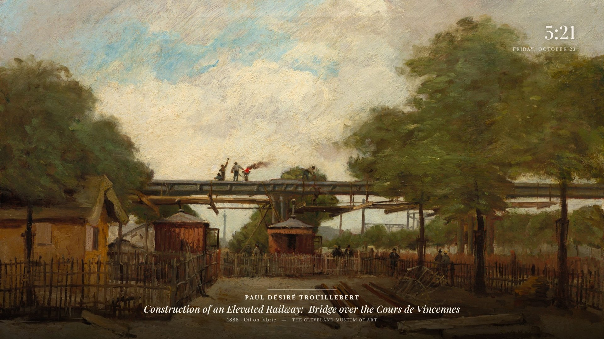<br><sub>Full bleed: the work fills the screen</sub></td>
</tr>
</table>

## Get it in three steps

1. **Install.** Download [`YourFrame.apk`](https://github.com/ismaelmelgar/YourFrame/releases/latest) and install it
   from a computer (or with any sideloading app):

   ```bash
   adb connect <TV-IP>:5555          # accept "Allow USB debugging?" on the TV
   adb install -r YourFrame.apk
   ```

2. **Set it up.** Open **YourFrame** from the apps row and pick a frame, a mat and what to show.
3. **Make it your screensaver.** Choose **Set as screensaver**:

- **Android TV** (e.g. Mi Box, Shield): it opens the system's screensaver settings; pick YourFrame there.
- **Google TV** (Chromecast with Google TV, Google TV Streamer, TVs with Google TV): Google TV doesn't list
  third-party screensavers. YourFrame sets itself through the TV's own debugging connection, the way Free My TV does:
  turn on *Developer options → USB debugging* (Settings → System → About → tap *Android TV OS build* 7 times), then
  *Set as screensaver*; the TV asks once *Allow USB debugging?* (tick *Always allow*). From a computer the same thing is

  ```bash
  adb shell settings put secure screensaver_components io.yourframe.tv/.ArtDream
  ```


## Questions

**Why doesn't YourFrame appear in Google TV's screensaver settings?**
Google TV only lists its own screensavers. YourFrame works around it through the TV's own debugging connection (the
one-time *Allow USB debugging?* prompt), or with the one-line `adb` command above. Classic Android TV lists it
normally.

**When does it start?**
Whenever the TV would start its screensaver. YourFrame doesn't change when the screensaver starts or when the screen
turns off. To see it right away, use *Preview* in the app.

**Does it use much data or memory?**
Each picture is downloaded at your screen's size (about 1–3 MB) once per change. On a Chromecast with Google TV it uses
about 65 MB of memory and runs smoothly.

**Which devices?**
Android TV and Google TV 8.0 and later: Chromecast with Google TV, Google TV Streamer, Nvidia Shield, Mi Box, and TVs
running Android TV or Google TV.

**Can I use these images?**
Yes. Every work is public domain or CC0, as published by its museum, and each caption names the museum.
YourFrame isn't affiliated with any of them.

## Credits

Images and data, all public domain; YourFrame isn't affiliated with or endorsed by any of these museums, and every
caption names the work's museum:

- [The Metropolitan Museum of Art](https://www.metmuseum.org/about-the-met/policies-and-documents/open-access): Open
  Access, CC0 1.0 (works with `isPublicDomain`).
- [The Cleveland Museum of Art](https://www.clevelandart.org/open-access): Open Access, CC0 1.0 (works whose
  `share_license_status` is CC0).
- [Statens Museum for Kunst, National Gallery of Denmark](https://www.smk.dk/en/article/smk-api/): public domain works,
  Public Domain Mark 1.0; images through SMK's IIIF server.
- [National Gallery of Art, Washington](https://github.com/NationalGalleryOfArt/opendata): open data CC0; open access
  images (`openaccess = 1`) CC0, through NGA's IIIF server.
- Fonts: Playfair Display and Libre Caslon Text, SIL Open Font License 1.1 (`app/assets/fonts`).
- Built on [Free My TV](https://github.com/simbasjungles/free-my-tv) (MIT): `build.sh`, the ADB client and the
  screensaver's structure. See `NOTICE`.

## For developers

YourFrame is a small plain-Java app (no libraries, no Gradle). How to build it, how the list of works is generated
from the museums' open data, and how the code is organised: [docs/DEVELOPMENT.md](docs/DEVELOPMENT.md).

## License

MIT (`LICENSE`). Third-party code, fonts and images keep their own terms: see Credits and `NOTICE`.
